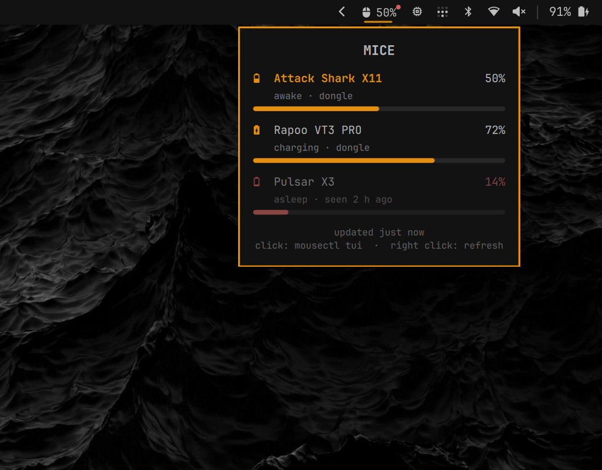

# d3m0nz.mousectl

An [Omarchy](https://omarchy.org) bar widget for the battery of your gaming mice, read with
[mousectl](https://github.com/D3m0nZOnFire/mousectl).



It's built for a desk with several mice connected at once (dongles in a dock) where you
only use one at a time:

- **The bar shows the mouse you're using.** mousectl can't see input, but a wireless mouse
  that's put down goes to sleep and stops answering. So the widget treats a mouse that
  answers as "recently used", and shows the one that woke up last. If you pick up another
  mouse, the bar switches to it on the next poll.
- **The other mice keep their last known level.** If one of them is under the low-battery
  threshold, a small red dot appears on the widget, so you know to charge it before you
  need it. Hover to see which one it is.
- **Hover the widget to see every connected mouse.** Each row shows the level, whether
  the mouse is charging, awake or asleep, and when it last answered. The mouse shown on
  the bar is highlighted. Last known levels are cached in
  `~/.cache/mousectl-omarchy.json`, so they survive a shell restart.

Bar label:

| label        | meaning |
|--------------|---------|
| `󰍽 73%`      | the mouse in use, at 73% |
| `󰍽 󱐋73%`     | charging |
| `󰍽 73%` dim  | every mouse is asleep; this is the last one that answered |
| `󰍽 73%` + red dot | another connected mouse is low |
| `󰍽 15%` red  | the mouse in use is low |
| `󰍽 !` red    | mousectl can't read it (the popup says why) |

When no supported mouse is connected, the widget hides.

Left click opens `mousectl tui`. Right click polls again right away.

## Requirements

mousectl 0.2.0 or newer on your `PATH` (`mousectl --version`), with access to the mice
(`mousectl install-udev` if `mousectl battery` reports a permission error).

## Install

```bash
omarchy plugin add https://github.com/D3m0nZOnFire/mousectl-omarchy.git --enable
```

The widget is added to the right side of the bar. Move it with
`omarchy bar move d3m0nz.mousectl --section <left|center|right>`.

## Settings

Set these in the widget's entry in `~/.config/omarchy/shell.json`:

| key            | default    | meaning |
|----------------|------------|---------|
| `intervalSec`  | `30`       | seconds between polls |
| `lowThreshold` | `20`       | percent at or under which a mouse counts as low |
| `command`      | `mousectl` | the mousectl executable, if it's not on `PATH` |

A poll talks to every connected mouse, one after another. A sleeping mouse takes a few
seconds to time out, so a poll can take several seconds. It runs in the background, once
for all monitors.

## IPC

Target `d3m0nz.mousectl`: `open`, `close`, `toggle`, `refresh`.

```bash
omarchy-shell d3m0nz.mousectl refresh
```

## How it works

`Service.qml` is the plugin's single background service. Every `intervalSec` it runs
`mousectl battery --json` and folds the result into what it already knows. The widget on
each monitor's bar only displays that state. The bars never run mousectl themselves:
two mousectl processes on one dongle would read each other's answers.

All the decision logic (which mouse is current, what counts as low, the status texts)
is in `Model.js`, which has no Qt dependencies. The widget relies on mousectl's
versioned JSON output ([docs/INTERFACE.md](https://github.com/D3m0nZOnFire/mousectl/blob/main/docs/INTERFACE.md)).
If mousectl reports an interface version it doesn't understand, the widget says so
instead of guessing.

## Tests

```bash
node test/model-test.js
```

## Compatibility

`BarWidget.qml` uses Omarchy's internal `qs.Ui` / `qs.Commons` components, which aren't a
stable plugin API. It was last checked against Omarchy 4.0.5 with Quickshell 0.3.2.

## License

MIT, see `LICENSE`.
